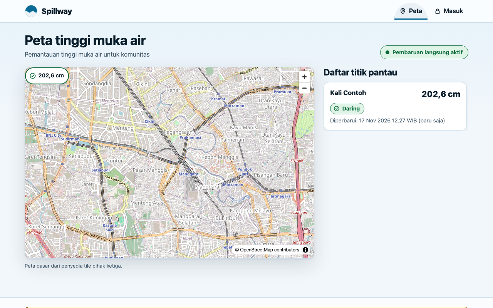
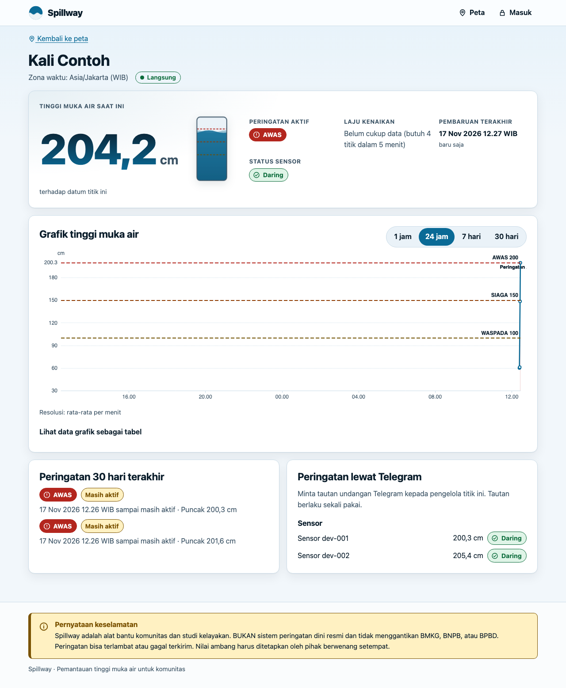
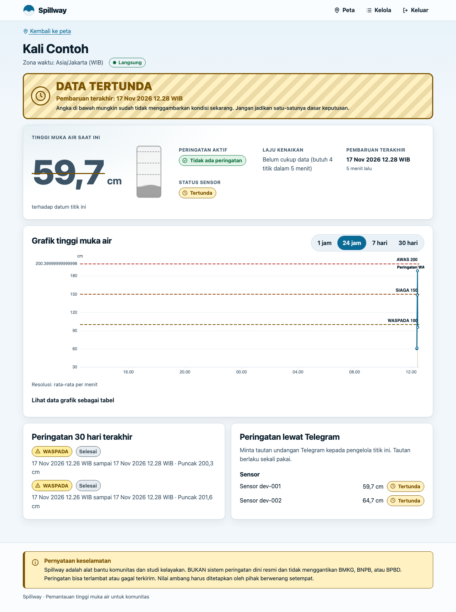
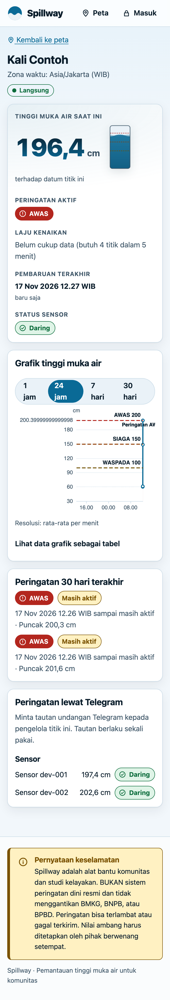
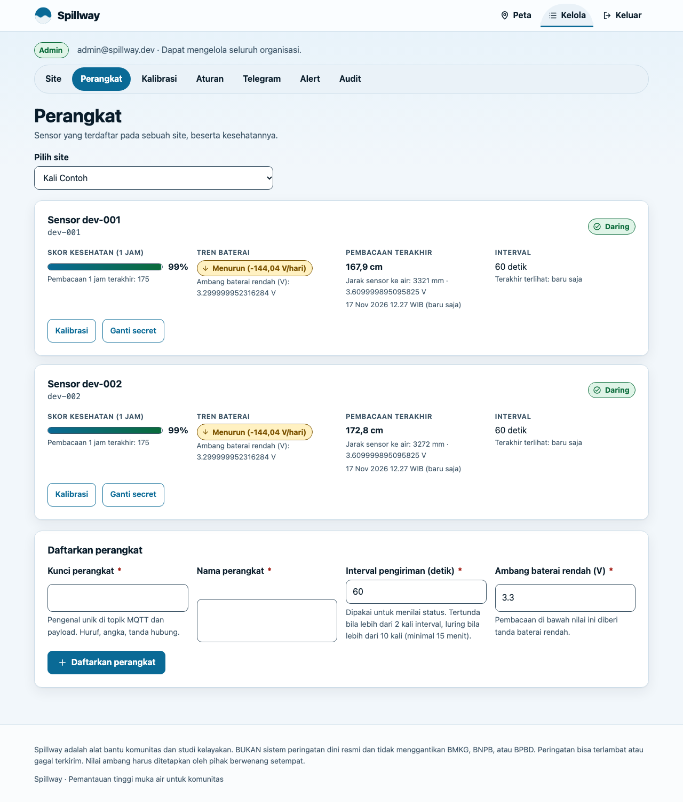
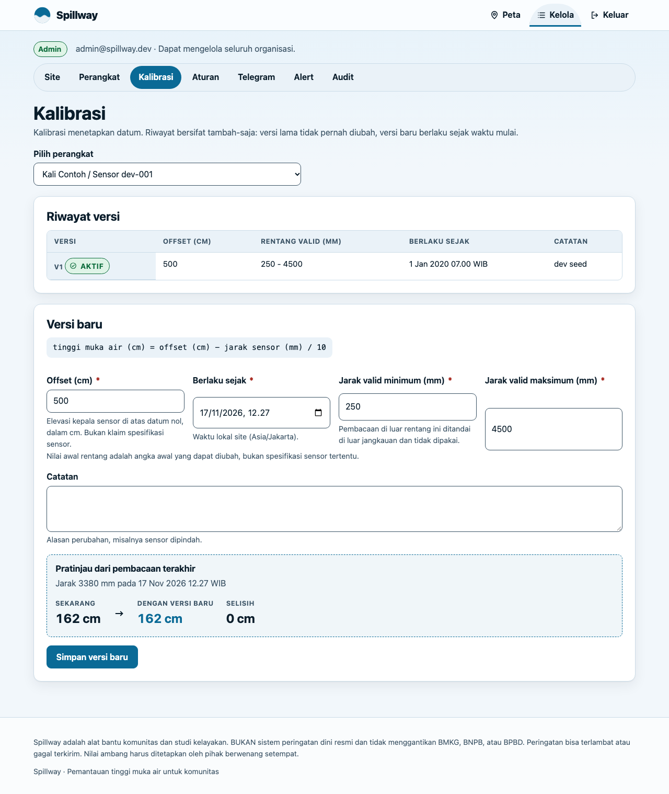
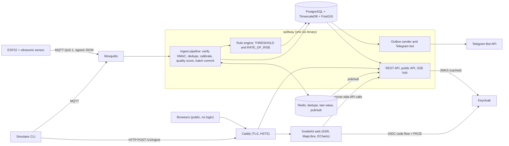

# Spillway

Open-source platform for communities (villages, flood-watch volunteers, small disaster agencies, researchers) that receives water-level readings from low-cost sensors, scores the quality of every reading, evaluates alert rules, and sends warnings, without the operator touching code.

> **Safety statement.** Spillway is a community aid and feasibility-study tool. It is **NOT an official early warning system** and does not replace BMKG, BNPB, or BPBD. Warnings can be late or fail to deliver. Threshold values must be set by the local authorities.
>
> *Indonesian (shown in the UI and in every Telegram alert):* "Spillway adalah alat bantu komunitas dan studi kelayakan. BUKAN sistem peringatan dini resmi dan tidak menggantikan BMKG, BNPB, atau BPBD. Peringatan bisa terlambat atau gagal terkirim. Nilai ambang harus ditetapkan oleh pihak berwenang setempat."

**Fail-visible principle:** stale data must never look current. If the newest reading is older than `max(2 x expected interval, 5 minutes)`, the public UI, the live stream, and Telegram messages show **DATA TERTUNDA** ("data delayed") with the time of the last update.

The UI and all notification text are in Indonesian (one central message file). Code, comments, and this README are in English.

## Contents

1. [The problem](#the-problem) | 2. [Features](#features) | [Screenshots](#screenshots) | 3. [Architecture](#architecture) | 4. [Data flow and idempotency](#data-flow-and-idempotency) | 5. [Data quality model](#data-quality-model) | 6. [Rule engine](#rule-engine) | 7. [Threat model](#threat-model-honest-limits) | 8. [Run it in development](#run-it-in-development-with-the-simulator) | 9. [Create the Telegram bot](#create-the-telegram-bot) | 10. [Build the ESP32 bucket demo](#build-the-esp32-bucket-demo) | 11. [Load test](#load-test) | 12. [Status per item](#status-per-item) | 13. [Docs](#documentation) | 14. [License](#license-and-owner)

## The problem

Small communities near rivers often have no water-level data of their own. Commercial telemetry is expensive and official stations may be far away. Cheap ultrasonic sensors fix the cost, but raw cheap-sensor data is hostile to alerting: echoes produce absurd spikes, sensors freeze, clocks drift, batteries sag, Wi-Fi drops and later delivers a backlog. A naive "level above X, send message" rule on such data either cries wolf (people stop trusting it) or stays silent when it matters.

Spillway is built around that gap: flood semantics (rate of rise, per-site thresholds, datum calibration with history), a quality score per reading so bad data cannot raise or hold an alarm, idempotent ingest so retries and restarts never double or lose a reading, and visible staleness so a dead sensor is never shown as "all clear".

The impact is a design goal, not a measured result: no field deployment has been run. What has been measured is listed under [Load test](#load-test) and in [docs/AUDIT.md](docs/AUDIT.md).

## Features

- **Sites and devices** on a map, with datum calibration kept as append-only versions (`valid_from`), managed in the admin UI.
- **Ingest over MQTT and HTTP**, HMAC-signed, idempotent, tolerant of duplicates, late and out-of-order messages.
- **Data quality**: out of range, spike (causal Hampel), flatline, clock skew, low battery, battery trend, freshness. Low-quality readings are stored but never drive alerts.
- **Two rule types**: tiered `THRESHOLD` and `RATE_OF_RISE` (OLS slope in cm/hour), with confirmation, hysteresis and anti-spam cooldown. Severities `WASPADA`, `SIAGA`, `AWAS`.
- **Telegram alerts** through an outbox with retry, per-site subscription by deep link, and `/start`, `/stop`, `/status`.
- **Live map and charts** (server-sent events) and a read-only public page per site.
- **OIDC login** (Keycloak, code flow with PKCE) with roles admin, operator, public; all data is scoped to an organization.
- **Fleet simulator** and a **measured load test**.
- **ESP32 firmware** for a bucket demo (ultrasonic sensor).
- **Docker Compose deployment** behind Caddy, and GitHub Actions CI.

Out of scope on purpose (see [docs/SPEC.md](docs/SPEC.md) section 3): LoRaWAN, SMS, web push, billing and full multi-tenant onboarding, Grafana, mobile apps, ML forecasting, EMQX, Kubernetes, other UI languages, e-mail, a third rule type (offline status is shown in the UI only).

## Screenshots

Real captures from the development stack (simulator `flood-wave` scenario, Keycloak development realm). Data is simulated.

| | |
|---|---|
|  |  |
| Public map: sites, live status | Site page at the peak: level gauge, active alert, chart with threshold lines |
|  |  |
| Fail-visible: no data for 5 minutes shows **DATA TERTUNDA** and strikes through the number | Same page at 375 px width |
|  |  |
| Admin: device health score, battery trend, last reading | Admin: append-only calibration versions |

More in [docs/screenshots/](docs/screenshots/README.md): normal state, rules, alerts, audit log, sites, and the Keycloak login.

## Architecture



Everything tenant-owned lives in PostgreSQL with an `org_id`; every query goes through an organization-scoped repository that refuses SQL that does not filter on it. Redis holds only reconstructible state (dedupe keys, last values, event fan-out). TimescaleDB gives hypertables, compression of chunks older than 7 days, configurable raw retention (default 90 days) and continuous aggregates `readings_1m`, `readings_1h`, `readings_1d` (quality-gated); the chart API chooses the resolution from the requested range.

## Data flow and idempotency

Payload (full spec in [docs/PROTOCOL.md](docs/PROTOCOL.md)):

```json
{"device":"dev-001","sid":"a1b2c3d4","fc":42,"ts":1767225600,"raw_mm":1234,"batt_v":3.71,"sig":"<64 hex>"}
```

`sig = HMAC-SHA256(device_secret, "device|sid|fc|ts|raw_mm|batt_v")`, compared in constant time, with golden vectors shared by server tests and firmware tests. A message that fails verification is rejected, counted, and never stored. The device secret is generated at registration, shown once, and stored AES-GCM encrypted under `SPILLWAY_SECRET_KEY`.

Idempotency key: `(device, sid, fc)` (`sid` is random per boot, `fc` increases within a session). Three layers, the last one decides:

1. a small in-memory ring per device,
2. Redis, checked before and marked **after** the row is committed (marking before commit would lose data if the process died in between; if Redis is down the pipeline fails open),
3. a unique index `readings(device_id, ts, sid, fc)` with `ON CONFLICT DO NOTHING ... RETURNING`.

Delivery semantics: MQTT QoS 1 with a persistent session and manual acknowledgement, so PUBACK goes out only after the commit; HTTP answers 200 only after the commit and 503 with `Retry-After` under backpressure (retrying is safe). The result is at-least-once on the wire and exactly one row in storage. Processing is sharded by device key so per-device order is kept while devices run in parallel; a full queue pushes back on producers and never drops silently.

Time handling: all timestamps are UTC; the display zone is per site (default `Asia/Jakarta`). A reading is `late` when it arrives more than 2 minutes after its `ts` (accepted up to 24 hours; older is rejected and counted). A late reading is stored and charted but only drives rules when its `ts` is within 5 minutes of the newest valid reading of that device. A device clock more than 10 minutes off is flagged `CLOCK_SKEW` (score 0.5) and still stored with the device `ts`. Calibration is chosen by reading time (`valid_from <= ts`), not by arrival time.

## Data quality model

Each reading gets flags and a score in `[0, 1]`; the point score is the **minimum** of the active component scores. Formulas, worked numbers and limits: [docs/QUALITY.md](docs/QUALITY.md).

| Flag | Condition | Score |
|---|---|---|
| `OUT_OF_RANGE` | `raw_mm` outside `[min_valid_mm, max_valid_mm]` (default 250 to 4500) | 0.0 |
| `SPIKE` | causal Hampel: median and MAD of the last 7 in-range values, threshold 3 x 1.4826 x max(MAD, 0.5 cm), needs 5 history values | 0.2 |
| `FLATLINE` | identical `raw_mm` on 20 consecutive readings | 0.3 |
| `CLOCK_SKEW` | device clock more than 10 minutes off | 0.5 |
| `LOW_BATTERY` | `batt_v` below the device threshold (default 3.3 V) | 0.9 |
| `LATE` | informational | 1.0 |

Readings with score below `min_quality` (default 0.5) are stored but ignored by rules. Device health (1 hour window) is `received / expected x mean point score`; the battery trend is the OLS slope of `batt_v` over 24 hours. Device status is `ONLINE`, `DELAYED` (older than 2 x interval) or `OFFLINE` (older than max(10 x interval, 15 minutes)).

Verified with numbers (independent hand calculation in [docs/AUDIT.md](docs/AUDIT.md)): on the `spike-noise` scenario the gate flags all 36 spikes in 300 readings and raises 0 alerts, while the same data without the gate opens 18 false alert cycles; the genuine flood wave has 0 false SPIKE flags.

Honest limits: five consecutive extreme but in-range readings are accepted as a real level change (the window adapts, documented); a sensor frozen at a high value can open one alert from its first 19 readings before `FLATLINE` triggers; very calm water can legitimately produce 20 identical 1 mm readings and be ignored until the value changes.

## Rule engine

- **`THRESHOLD`**, `tiers = [{level_cm, severity}]`: opens or raises severity when `level_cm` passes a tier in 2 of the last 3 valid readings; lowers or closes when below the tier minus `hysteresis_cm` (default 5) on 3 consecutive valid readings.
- **`RATE_OF_RISE`**, `tiers = [{cm_per_hour, severity}]`: OLS regression over valid readings of the last 10 minutes (at least 4 points spanning at least 5 minutes); confirmed over 2 consecutive evaluations; hysteresis 20 percent of the tier.
- One open `alert_event` per rule; severity changes happen on the same event. Notifications: immediately on `OPENED` and `ESCALATED`, one reminder per cooldown (default 30 minutes) at the same severity and only with fresh data, once on de-escalation and once on `CLOSED`. Every message carries site, severity, level, rate when known, local time, the public page link and the safety statement.
- The window state is rebuilt from the database at start and yields exactly the state the live engine had (tested, including a crash between "decision" and "commit").

Worked example, flood-wave scenario (300 readings at 1 per minute, base 60 cm, peak 200 cm, tiers 100/150/190 cm), computed by hand and then compared with the system (`internal/simulate/handcalc_test.go`): OPENED at minute 93, ESCALATED at 115 and 137, REMINDER at 167 and 197, DEESCALATED at 207 and 234, CLOSED at 263. That is 8 notifications per subscribed channel. The OLS rate peaks at 141.5 cm/hour at minute 117.

## Threat model (honest limits)

| Area | What is in place | Limit you must know |
|---|---|---|
| Device identity | Per-device HMAC secret, constant-time check, secret shown once, AES-GCM at rest, key rotation (`SPILLWAY_SECRET_KEY_VERSION` and `_OLD`) | Devices share ONE broker account (it may only publish telemetry). Anyone holding it can send to any device topic, but still needs that device's valid HMAC. Per-device broker credentials are in the backlog |
| Replay | Counter `fc` per session, idempotency key, timestamp window (24 hours) | A captured valid message can be replayed once within its window if the original never reached the server; replays of delivered messages are dropped as duplicates. HMAC does not hide the payload |
| Transport | Caddy terminates TLS with HSTS; MQTT TLS on 8883 when certificates are mounted | Without configuring TLS the device link is plain text (HMAC still protects integrity, not confidentiality). The plain MQTT port binds to loopback by default |
| Telegram | Bot token only in env and never logged; messages HTML-escaped; subscription tokens are single use and stored hashed | Telegram availability and delivery are outside our control. Telegram has no idempotency key, so a crash between "sent" and "marked sent" can duplicate one message. In a group any member can `/stop` |
| Not an official system | Safety statement in README, UI and every message; fail-visible staleness | Spillway is not certified, not redundant, has a single server, and must not be the only warning channel |
| Accounts | Keycloak OIDC with PKCE, tokens never reach browser JavaScript (server-side session, `httpOnly` cookie), JWT verified through cached JWKS, `org` claim hardcoded by the realm | Web sessions live in memory (a restart signs everyone out; one web instance). The Keycloak admin console is reachable only through an SSH tunnel |
| Tenancy | Every query is organization-scoped (runtime guard, AST test, 18 cross-organization negative tests over all authenticated endpoints) | Isolation is enforced in application code; Postgres row-level security is in the backlog |
| Public endpoints | Read-only, only `is_public` sites, rate limited per IP, no internal ids or secrets | The default OpenStreetMap tile server is for demo scale only |
| Secrets | `.env`, `secrets.h`, `devices.json` are git-ignored; production refuses the published development master key | Losing `SPILLWAY_SECRET_KEY` makes every device secret unreadable: back it up separately from database dumps |

## Run it in development with the simulator

Requirements: Go (see `go.mod`), Node 24+, Docker with Compose, `golangci-lint` (only for `make verify`).

```sh
make dev-up        # Postgres+TimescaleDB+PostGIS, Redis, Mosquitto, Keycloak (copies .env.example to .env)
make migrate       # database migrations and the raw-data retention policy
set -a; . ./.env; set +a
go run ./cmd/spillway seed-dev | tee seed.txt     # demo org, 2 sites, 3 devices; secrets are printed ONCE
go run ./cmd/spillway serve                       # API on :8080 plus MQTT ingest; keep it running
```

In a second terminal, turn the printed secrets into the simulator's device file and send a flood wave (`devices.json` and `seed.txt` are git-ignored):

```sh
set -a; . ./.env; set +a
printf '[' > devices.json
awk -F'[ =]' '/^device=/{printf "%s{\"device\":\"%s\",\"secret\":\"%s\"}", (n++?",":""), $2, $6}' seed.txt >> devices.json
printf ']' >> devices.json
# .env sets MQTT_USERNAME=spillway (read-only service account); devices publish with the "device" account:
MQTT_USERNAME=device MQTT_PASSWORD="$MQTT_DEVICE_PASSWORD" \
  go run ./cmd/simulator -devices-file devices.json -mqtt tcp://127.0.0.1:1883 -scenario flood-wave -interval 1s -duration 5m
```

Scenarios: `steady`, `flood-wave`, `spike-noise`, `flatline`, `dropout`, `late-burst`; fault injection with `-duplicate-rate`, `-late-rate`, `-out-of-order-rate`; HTTP instead of MQTT with `-http http://127.0.0.1:8080/v1/ingest`; JSON report with `-report file.json`.

Web UI and admin: `make web-dev` serves http://localhost:3000 (public map and site pages; admin login `admin.dev` / `dev-admin-password`, development realm only). If `seed-dev` says the organization already exists it prints no secrets: register a new device in the admin UI, or wipe the dev data with `docker compose --env-file .env -f deploy/compose/docker-compose.dev.yml down -v` and start again.

Other commands: `make verify` (go vet, golangci-lint, `go test -race`, web check, lint, tests, build; needs Docker for the integration tests, 10 to 15 minutes), `make web-e2e` (Playwright against a mock API), `make smoke` (production compose stack over HTTP, see [docs/DEPLOY.md](docs/DEPLOY.md)), `go run ./cmd/spillway sub-link dev kali-contoh` (Telegram invite link). Endpoints on `serve`: `/healthz`, `/readyz` (Postgres, Redis, MQTT), `/metrics`. API contract: [docs/openapi.yaml](docs/openapi.yaml), kept in sync with the router by a test.

## Create the Telegram bot

1. In Telegram, open `@BotFather`, send `/newbot`, choose a display name and a unique username ending in `bot`.
2. BotFather replies with a token (`123456789:AA...`). Treat it like a password: never commit it or paste it into chats or logs. If it leaks, send `/revoke`.
3. Set it in the environment: `TELEGRAM_BOT_TOKEN`, `TELEGRAM_BOT_USERNAME` (without `@`), `PUBLIC_BASE_URL` (for links in alerts). With an empty token alerts are still stored and queued; nothing is sent.
4. Create an invite link: `go run ./cmd/spillway sub-link <org-slug> <site-slug>` or the Telegram page in the admin UI. Open it in Telegram and press Start. Links are single use and expire after 24 hours.

The bot uses long polling (no webhook, no public address). Full details and the real-bot checklist: [docs/TELEGRAM.md](docs/TELEGRAM.md) and [docs/ENV_TEST.md](docs/ENV_TEST.md). Telegram with a real bot has not been exercised by the author (tests use a mock Telegram server).

## Build the ESP32 bucket demo

Hardware: ESP32 DevKit (30 or 38 pin), JSN-SR04T waterproof ultrasonic sensor (or HC-SR04 with a 1 kOhm / 2 kOhm divider on ECHO), a bucket at least 40 cm deep, a ruler. Wiring, build, and calibration details: [firmware/esp32/README.md](firmware/esp32/README.md).

1. Register a site and a device in the admin UI; copy the secret (shown once).
2. `cd firmware/esp32 && cp include/secrets.example.h include/secrets.h`, then fill in Wi-Fi, broker, `DEVICE_KEY`, `DEVICE_SECRET_HEX`.
3. `pio test -e native` (9 host tests against the protocol golden vectors), then `pio run -t upload && pio device monitor`. Expected on serial: HMAC self-test passes, Wi-Fi and NTP come up, then one reading every 30 seconds.
4. Mount the sensor facing straight down over the bucket. Fill to 10, 20 and 30 cm (ruler) and note `raw_mm` at each depth. `offset_cm = depth + raw_mm / 10`. The three results should agree within about 1 cm; use the average as a new calibration version in the admin UI. The admin preview should now show the ruler depth within roughly 1 cm.
5. Add a `THRESHOLD` rule for the site (for example 15 cm WASPADA, 25 cm SIAGA), raise the water through the thresholds: an alert opens and escalates, the public page follows, Telegram messages arrive if the bot is configured. Lower the water: de-escalation and close follow after 3 readings below the threshold minus the hysteresis.
6. Unplug Wi-Fi for 6 minutes: the public page shows **DATA TERTUNDA** with the last update time, and recovers by itself.

Honest expectations: accuracy is about 1 cm at best (3 mm resolution, no temperature sensor, 28 C assumed), rain and foam add noise, and the node is mains or solar powered (no deep sleep). The firmware compiles (`pio run`) and passes host tests; it has **not** been run on real hardware by the author.

## Load test

`tools/loadtest` drives N simulated devices over MQTT through baseline, 10x burst and recovery phases and reads Spillway's own metrics. Reproduce (details and caveats in [docs/LOADTEST.md](docs/LOADTEST.md)):

```sh
export C="docker compose --env-file deploy/compose/.env.prod -f deploy/compose/docker-compose.prod.yml"
$C up -d --build
( umask 077; $C run --rm -T -e SPILLWAY_ENV=dev spillway seed-load 10000 /dev/stdout > load-devices.json )
export MQTT_USERNAME=device MQTT_PASSWORD="$(grep ^MQTT_DEVICE_PASSWORD= deploy/compose/.env.prod | cut -d= -f2)"
go run ./tools/loadtest -devices-file load-devices.json -devices 10000 -mqtt tcp://127.0.0.1:1883 \
  -interval 30s -rate-multiplier 1 -baseline 90s -burst 60s -burst-factor 10 -recovery 60s -out loadtest-result.json
```

Measured on one laptop (Apple M1, 8 cores, Docker VM with 8 CPUs and 4 GB, load generator on the same machine, 2% duplicates, 1% late, 2% out of order injected, MQTT QoS 1). Raw JSON is in [docs/loadtest-results/](docs/loadtest-results/).

| | 1,000 devices (time compressed 10x) | 10,000 devices (real 30 s interval) |
|---|---|---|
| Unique messages acknowledged by the broker | 260,000 | 250,000 |
| Rows in the database | 260,000 | 250,000 |
| **Lost** | **0** | **0** |
| Peak rate reached (10x burst) | 3,411 msg/s | 3,563 msg/s |
| Ingest latency p50 / p95 / p99 at burst (receive to commit) | 75 / 188 / 374 ms | 54 / 213 / 372 ms |
| Peak queue depth | 403 | 507 |

Context that matters: these are laptop numbers, not VPS numbers; the load generator shares the CPU; the 10,000-device run bursts all devices on the same second, which is harsher than a real fleet; the p99 near 505 ms is a histogram bucket edge; the 1,000-device recovery phase had a p99 of 3.7 s that was not investigated; runs lasted minutes, so long-term behavior (chunk compression, retention, multi-day growth) and the maximum capacity were **not** measured. Nothing is extrapolated, and no VPS claim is made.

A separate chaos run on the production compose stack (20 devices over MQTT, Postgres stopped for 20 s, Mosquitto for 8 s, the app killed with SIGKILL) ended with 960 broker-acknowledged unique messages, 960 rows, 0 duplicates (details in [docs/AUDIT.md](docs/AUDIT.md)).

## Status per item

Status words follow the project contract: `SELESAI-TERVERIFIKASI` (a test or build was actually run), `SELESAI-PERLU-UJI-LINGKUNGAN` (code and tests written; needs real hardware, a real bot, or a VPS). The audit trail is [docs/AUDIT.md](docs/AUDIT.md); what the owner must test is [docs/ENV_TEST.md](docs/ENV_TEST.md).

| # | Item | Status | Notes |
|---|---|---|---|
| 1 | Sites, devices, calibration with history, admin UI | SELESAI-TERVERIFIKASI | API tests, Playwright form test, run against real Keycloak in a browser |
| 2 | MQTT and HTTP ingest, idempotent | SELESAI-TERVERIFIKASI | Real Mosquitto, Redis, TimescaleDB; Redis outage, restart, and chaos runs |
| 3 | Data quality score | SELESAI-TERVERIFIKASI | Unit tests, hand-computed numbers, rebuild equals live |
| 4 | `THRESHOLD` and `RATE_OF_RISE` rules | SELESAI-TERVERIFIKASI | End-to-end lifecycle, restart, hand-computed ticks |
| 5 | Telegram notifications | SELESAI-PERLU-UJI-LINGKUNGAN | Tested against a mock Telegram server only |
| 6 | Map, SSE, public page | SELESAI-TERVERIFIKASI | Real simulator observed; real OSM tiles not tested |
| 7 | OIDC auth, roles, org isolation | SELESAI-TERVERIFIKASI | Real dev Keycloak; production realm and TLS need the owner |
| 8 | Simulator and load test | SELESAI-TERVERIFIKASI | Laptop only; VPS not measured |
| 9 | ESP32 demo firmware | SELESAI-PERLU-UJI-LINGKUNGAN | Compiles, 9 host tests; never run on hardware |
| 10 | Compose + Caddy + CI | SELESAI-PERLU-UJI-LINGKUNGAN | Compose smoke (including restart recovery) passes locally; CI never run on GitHub; VPS, DNS, public TLS untested |

## Documentation

[docs/DEPLOY.md](docs/DEPLOY.md) (VPS, DNS, backup, rotation) | [docs/PROTOCOL.md](docs/PROTOCOL.md) (wire format, golden vectors) | [docs/QUALITY.md](docs/QUALITY.md) | [docs/TELEGRAM.md](docs/TELEGRAM.md) | [docs/LOADTEST.md](docs/LOADTEST.md) | [docs/ENV_TEST.md](docs/ENV_TEST.md) | [docs/AUDIT.md](docs/AUDIT.md) | [docs/DECISIONS.md](docs/DECISIONS.md) | [docs/BACKLOG.md](docs/BACKLOG.md) | [docs/BLOCKERS.md](docs/BLOCKERS.md) | [docs/PROGRESS.md](docs/PROGRESS.md).  Screenshot index: [docs/screenshots/README.md](docs/screenshots/README.md).

Basemap tiles: set `TILE_URL`. The default public OpenStreetMap server is for small-scale demos only and requires attribution ("(c) OpenStreetMap contributors"); follow the [OSM tile usage policy](https://operations.osmfoundation.org/policies/tiles/) or use your own provider beyond a demo.

## License and owner

MIT License. Copyright (c) 2026 Vassel Goleyu. Created and owned by Vassel Goleyu; see [LICENSE](LICENSE).
